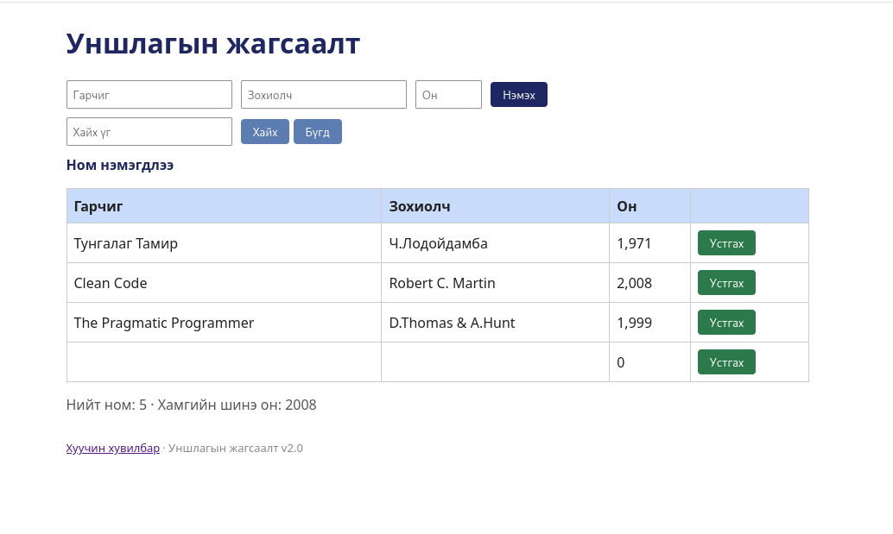

# BUG-01: Ном нэмэх маягт Гарчиг, Зохиолч, Он талбарыг хоосон/дутуу байхад ч ном нэмдэг

Орчин:  Уншлагын жагсаалт v2.0, Firefox 153.0, Debian GNU/Linux 13 (trixie), 2026-10-21
Урьдчилсан нөхцөл: node app.js-ийг шинээр асаасан (анхны 3 ном)

## Дахин гаргах алхам

1. Терминалд `node app.js` ажиллуул (өмнө нь ажиллаж байсан бол Ctrl+C хийгээд дахин асаа).
2. Браузераар http://localhost:3000 нээ (хүснэгтэд 3 ном байна).
3. Гарчиг, Зохиолч, Он гурван талбарыг бүгдийг нь хоосон үлдээгээд «Нэмэх» товчийг дар.
4. Хүснэгтийн доод хэсгийг хар: хоосон мөр нэмэгдсэн.
5. Дараа нь нэг талбарыг л бөглөөд (жишээ нь Гарчигт "Test" гэж бичээд, Зохиолч, Он хоосон) «Нэмэх» дар. Дахин мөр нэмэгдэнэ.

Хүлээгдэж байсан: Спецификац: «Ном нэмэхэд Гарчиг, Зохиолч, Он гурван талбар бүгд заавал бөглөгдсөн байх ёстой; дутуу бол ном нэмэгдэхгүй, ойлгомжтой алдааны мессеж харагдана.»
Бодит үр дүн:     Ном хоосон гарчиг/зохиолчтойгоор (он нь 0 гэж) хүснэгтэд нэмэгдэнэ. Алдааны мессеж гарсангүй, өөрөөр хэлбэл дутуу оролтыг хориглохгүй.
Ноцтой байдал: Major, өгөгдлийн бүрэн бүтэн байдал алдагдаж, хоосон мөрүүд жагсаалтыг бохирдуулна.
Хавсралт:      
Олдсон аялал:  Couch Potato (хоосон оролт)

> ⚠️ ШАЛГАХ: алхам 3-4-ийн дараа дэлгэц дээр ямар мессеж гарч байгааг үгчлэн энд бич, дараа нь энэ мөрийг устга.
