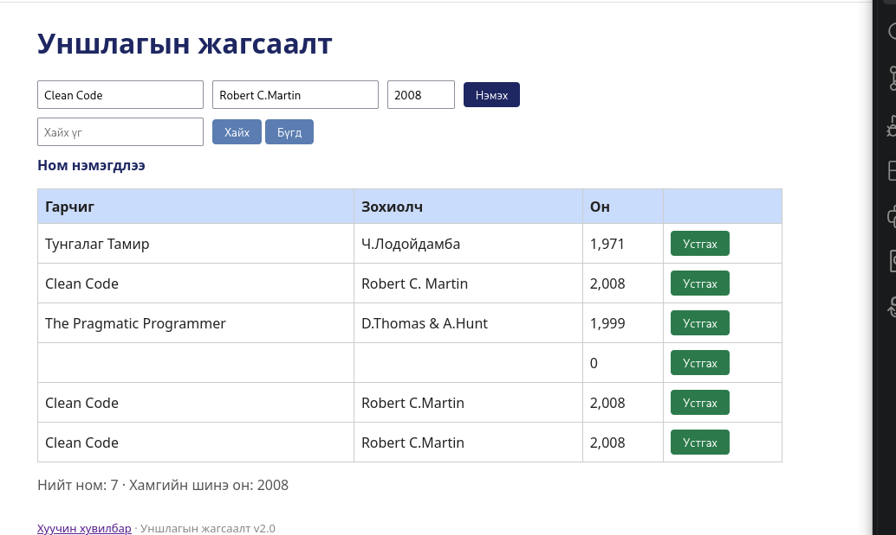

# BUG-02: Ижил гарчиг, зохиолчтой номыг дахин нэмэхэд давхардуулан нэмдэг

Орчин:  Уншлагын жагсаалт v2.0, Firefox 153.0, Debian GNU/Linux 13 (trixie), 2026-10-21
Урьдчилсан нөхцөл: node app.js-ийг шинээр асаасан (анхны 3 ном)

## Дахин гаргах алхам

1. `node app.js`-ийг шинээр асаа.
2. http://localhost:3000 нээ. Хүснэгтэд "Clean Code / Robert C. Martin / 2008" ном байгааг харж баталгаажуул.
3. Гарчиг талбарт `Clean Code`, Зохиолч талбарт `Robert C. Martin`, Он талбарт `2008` гэж бичээд «Нэмэх» дар.
4. Хүснэгтэд яг ижил "Clean Code" мөр хоёр удаа харагдана.
5. Дахин «Нэмэх» дарахад гурав дахь ижил мөр нэмэгдэнэ.

Хүлээгдэж байсан: Спецификац: «Ижил гарчиг, зохиолчтой ном давхардуулж нэмэгдэхгүй.»
Бодит үр дүн:     Ижил ном хэдэн ч удаа нэмэгдэж, хүснэгтэд давхардсан мөрүүд үүснэ.
Ноцтой байдал: Major, жагсаалт давхардсан өгөгдлөөр дүүрч, хэрэглэгч ижил номыг олон удаа харна.
Хавсралт:      
Олдсон аялал:  Fed-Ex (өгөгдлийн зам: нэмэх → хүснэгт)
