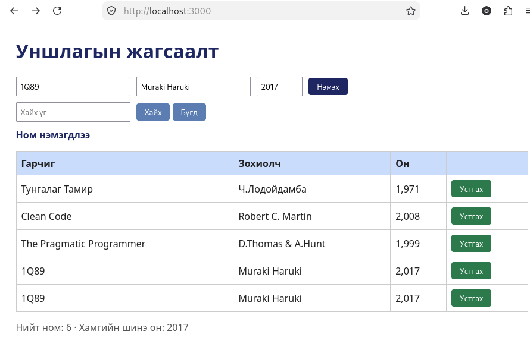

# BUG-03: «Нийт ном» тоолуур хүснэгтэд байгаа номын тооноос 1-ээр их гарна

Орчин:  Уншлагын жагсаалт v2.0, Firefox 153.0, Debian GNU/Linux 13 (trixie), 2026-10-21
Урьдчилсан нөхцөл: node app.js-ийг шинээр асаасан (анхны 3 ном)

## Дахин гаргах алхам

1. `node app.js`-ийг шинээр асаа.
2. http://localhost:3000 нээ. Хүснэгтийн мөрийг тоол, хүснэгтийн доорх «Нийт ном: N» тоотой харьцуул.
3. Гарчигт `Test`, Зохиолчид `Tester`, Онд `2000` гэж бичээд «Нэмэх» дар.
4. Хүснэгтийн мөрийг дахин тоол (4 мөр), «Нийт ном: N» тоотой харьцуул.

Хүлээгдэж байсан: Спецификац: «"Нийт ном" тоолуур хүснэгтэд буй номын тоотой тэнцүү.»
Бодит үр дүн:     Хүснэгтэд 5 ном байхад «Нийт ном: 6» гэж, өөр үед хүснэгтэд 6 мөр байхад «Нийт ном: 7» гэж харагдсан, өөрөөр хэлбэл тоолуур хүснэгтээс 1-ээр их байна.
Ноцтой байдал: Minor, өгөгдөл өөрөө эвдрэхгүй ч хэрэглэгчид худал тоо үзүүлнэ.
Хавсралт:      
Олдсон аялал:  Fed-Ex (өгөгдлийн зам: нэмэх → хүснэгт → тоолуур)

> ⚠️ ШАЛГАХ: шинэ асаалт дээр тоолуур яг хэд гэж гарч байгааг (3 үү, 4 үү) хар. Алхам 2, 4 дээр тоо яг ямар гарсныг дээрх "Бодит үр дүн"-д тодорхой бич (жишээ: "3 мөр, Нийт ном: 4"). Дараа нь энэ мөрийг устга.
