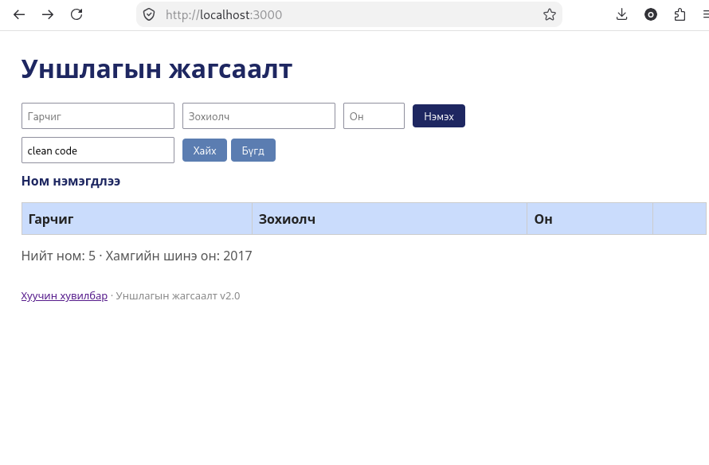

# BUG-05: Хайлт том/жижиг үсгийг ялгадаг (гарчиг болон зохиолчоор хайхад)

Орчин:  Уншлагын жагсаалт v2.0, Firefox 153.0, Debian GNU/Linux 13 (trixie), 2026-10-21
Урьдчилсан нөхцөл: node app.js-ийг шинээр асаасан (анхны 3 ном)

## Дахин гаргах алхам

1. `node app.js`-ийг шинээр асаа.
2. http://localhost:3000 нээ.
3. «Хайх үг» талбарт `Clean Code` гэж бичээд «Хайх» дар. "Clean Code" мөр гарна (зөв).
4. «Бүгд» дараад талбарт `clean code` (бүгд жижиг үсгээр) бичиж «Хайх» дар.
5. Үр дүн хоосон байна.
6. «Бүгд» дараад `robert c. martin` (жижиг үсгээр) бичиж «Хайх» дар. Үр дүн мөн хоосон.

Хүлээгдэж байсан: Спецификац: «Хайлт гарчиг болон зохиолчоос хайх ба том/жижиг үсэг ЯЛГАХГҮЙ.» Иймд `clean code`-оор "Clean Code" гарах ёстой.
Бодит үр дүн:     Яг ижил том/жижиг үсгээр бичсэн үед л үр дүн гарна, үсгийн хэлбэр өөр бол хоосон болно (гарчиг ба зохиолч хоёрт хоёуланд нь).
Ноцтой байдал: Major, хайлтын үндсэн үүрэг алдагдаж, хэрэглэгч байгаа номоо олохгүй.
Хавсралт:      
Олдсон аялал:  Fed-Ex (өгөгдлийн зам: нэмэх → хайх)
