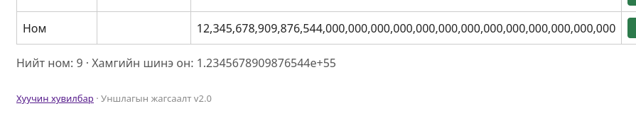

# BUG-06: Он талбар үсэг, тэмдэгт, мужаас гадуурх болон хэт том тоог шалгахгүйгээр хүлээн авдаг

Орчин:  Уншлагын жагсаалт v2.0, Firefox 153.0, Debian GNU/Linux 13 (trixie), 2026-10-21
Урьдчилсан нөхцөл: node app.js-ийг шинээр асаасан (анхны 3 ном)

## Дахин гаргах алхам

1. `node app.js`-ийг шинээр асаа.
2. http://localhost:3000 нээ.
3. Гарчигт `Test`, Зохиолчид `Tester` бичиж, Он талбарт үсэг/тэмдэгт (жишээ нь `abc`) оруулаад «Нэмэх» дар. Талбар үсгийг хүлээн авна.
4. Дахин Гарчигт `Test2`, Зохиолчид `Tester` бичиж, Он талбарт 30-аас олон оронтой тоо (жишээ нь `1234567890123456789012345678901234567890`) оруулаад «Нэмэх» дар.
5. Хүснэгтэд эхний ~17 орон нь таслалтай харагдаж, үлдсэн орон нь 0 болсон байна.
6. Хүснэгтийн доорх «Хамгийн шинэ он» тоог хар: экспоненциал хэлбэрээр (жишээ нь `e+55` гэх мэт) харагдана.

Хүлээгдэж байсан: Спецификац: «Он нь 1000-2100 хоорондох бүхэл тоо; хүснэгтэд энгийн тоогоор (жишээ нь 1999) харагдана.» Үсэг, мужаас гадуурх тоо, хэт том тоо хүлээн авагдах ёсгүй.
Бодит үр дүн:     Он талбар үсэг, тэмдэгтийг хүлээн авч, 1000-2100 мужаас гадуурх маш том тоог тайвнаар нэмдэг. Том тоо нь нарийвчлалаа алдаж (эхний 17 орноос хойш 0), «Хамгийн шинэ он» нь `e+55` хэлбэрээр харагдаж байна.
Ноцтой байдал: Major, оролтын шалгалт огт байхгүй тул өгөгдөл эвдэрч, хуудасны үзүүлэлт утгагүй болно.
Хавсралт:      
Олдсон аялал:  Couch Potato (хоосон/хачин оролт)

> ⚠️ ШАЛГАХ: алхам 3-ын дараа хүснэгтэд он ямар утгатай (0 үү, хоосон уу) харагдсаныг "Бодит үр дүн"-д нэм. Алхам 4-д яг ямар тоо оруулахад `e+NN` гарсан, түүнийг тааруул (оруулсан тооны оронгийн тоо). Дараа нь энэ мөрийг устга.
