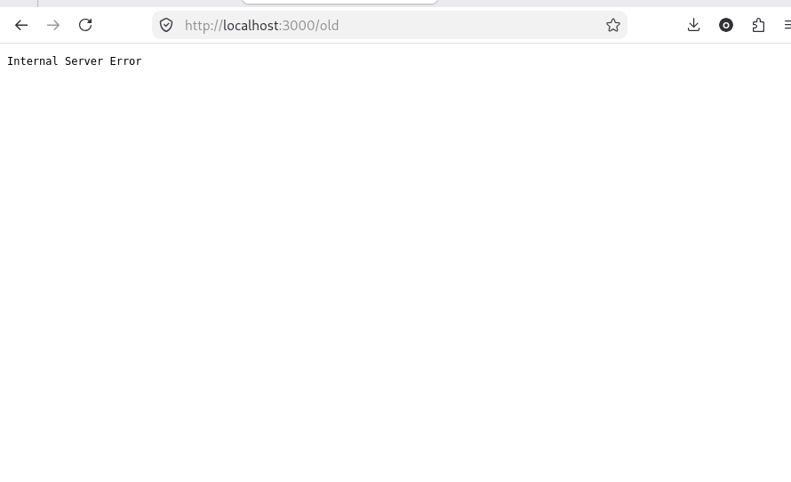

# BUG-07: Хуудасны доорх «Хуучин хувилбар» линк (/old) 500 Internal Server Error буцаана

Орчин:  Уншлагын жагсаалт v2.0, curl 8.14.1, Firefox 153.0, Debian GNU/Linux 13 (trixie), 2026-10-21
Урьдчилсан нөхцөл: node app.js-ийг шинээр асаасан (анхны 3 ном)

## Дахин гаргах алхам

1. `node app.js`-ийг шинээр асаа.
2. http://localhost:3000 нээ.
3. Хуудасны хамгийн доод талын «Хуучин хувилбар» линк дээр дар.
4. Хөтчийн хаяг `http://localhost:3000/old` болж, хуудсанд зөвхөн `Internal Server Error` гэсэн текст харагдана.
5. Нотолгоо: терминалд `curl -i localhost:3000/old` ажиллуулахад `HTTP/1.1 500 Internal Server Error` буцна.

Хүлээгдэж байсан: Спецификац: «Бүх хуудас, линк ажиллана.»
Бодит үр дүн:     Линк дээр дарахад хуудас нээгдэхгүй, сервер 500 алдаа буцаана.
Ноцтой байдал: Major, хуудсан дээрх линк ажиллахгүй, хэрэглэгч хуучин хувилбарт хүрч чадахгүй.
Хавсралт:       · evidence/bug-07-curl.txt
Олдсон аялал:  Charter-аас гадуур (санамсаргүй олдсон, линк дээр дарж үзэх үед)
