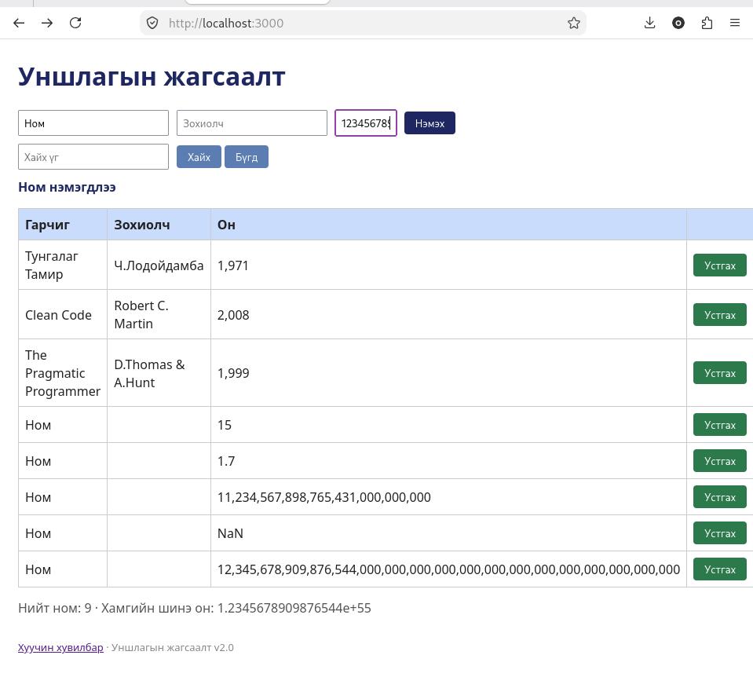

# BUG-08: Хүснэгтэд он мянгатын таслалтай (1,971) харагддаг

Орчин:  Уншлагын жагсаалт v2.0, Firefox 153.0, Debian GNU/Linux 13 (trixie), 2026-10-21
Урьдчилсан нөхцөл: node app.js-ийг шинээр асаасан (анхны 3 ном)

## Дахин гаргах алхам

1. `node app.js`-ийг шинээр асаа.
2. http://localhost:3000 нээ.
3. Хүснэгтийн «Он» баганыг хар: "Тунгалаг Тамир" мөрийн он `1,971`, "Clean Code" мөрийн он `2,008`, "The Pragmatic Programmer" мөрийн он `1,999` гэж харагдана.
4. (Давтан шалгах) Гарчигт `Test`, Зохиолчид `Tester`, Онд `1971` бичиж «Нэмэх» дар. Шинэ мөр `1,971` гэж харагдана.

Хүлээгдэж байсан: Спецификац: «Он ... хүснэгтэд энгийн тоогоор (жишээ нь 1999) харагдана.»
Бодит үр дүн:     Он мянгатын таслалтай, жишээ нь `1,971`, `2,008`, `1,999` гэж харагдана.
Ноцтой байдал: Minor, өгөгдөл зөв хадгалагдсан ч жилийг тоо шиг форматлаж, буруу харуулна.
Хавсралт:      
Олдсон аялал:  Fed-Ex (өгөгдлийн зам: хадгалсан утга → хүснэгтэд харагдах байдал)
