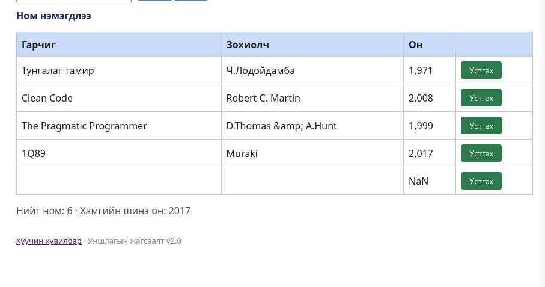

# BUG-09: «Устгах» товч ногоон өнгөтэй

Орчин:  Уншлагын жагсаалт v2.0, Firefox 153.0, Debian GNU/Linux 13 (trixie), 2026-10-21
Урьдчилсан нөхцөл: node app.js-ийг шинээр асаасан (анхны 3 ном)

## Дахин гаргах алхам

1. `node app.js`-ийг шинээр асаа.
2. http://localhost:3000 нээ.
3. Хүснэгтийн мөр бүрийн баруун талын «Устгах» товчийг хар: ногоон өнгөтэй.

Хүлээгдэж байсан: Спецификац: «Аюултай үйлдлийн товч (Устгах) улаан өнгөтэй байх ёстой.»
Бодит үр дүн:     «Устгах» товч бүх мөрөнд ногоон өнгөтэй.
Ноцтой байдал: Cosmetic, функц зөв ажилладаг ч аюултай үйлдлийг ногоон (аюулгүй) өнгөөр илэрхийлэх нь хэрэглэгчийг төөрөгдүүлнэ.
Хавсралт:      
Олдсон аялал:  Charter-аас гадуур (санамсаргүй олдсон, UI-ийн өнгө ажиглах үед)
